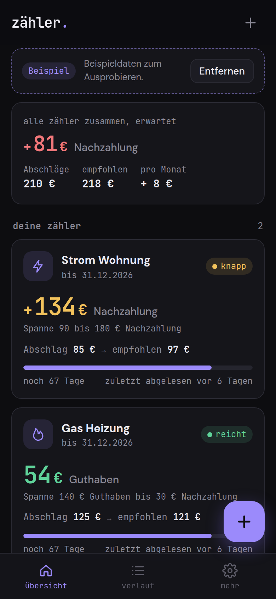
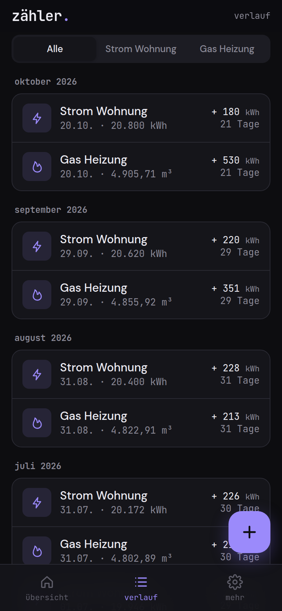
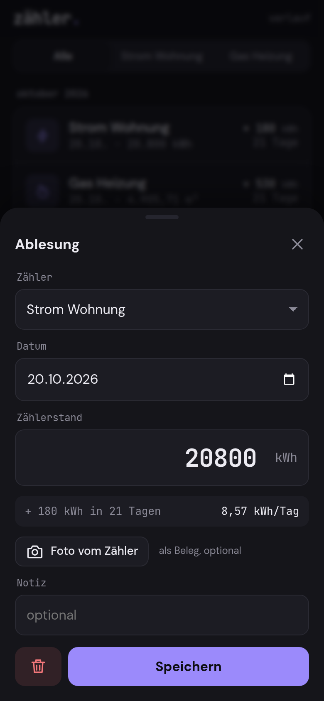

# zähler.

**Reicht dein Abschlag?** zähler. sagt es dir, bevor die Jahresabrechnung kommt.

Jeder Haushalt zahlt jeden Monat einen Abschlag für Strom, Gas, Wasser oder Fernwärme. Ob das Geld reicht, erfährst du normalerweise erst mit der Jahresabrechnung, manchmal zusammen mit einer Nachzahlung von ein paar hundert Euro. zähler. dreht das um: Du tippst einmal im Monat deinen Zählerstand ein, die App rechnet aufs Abrechnungsjahr hoch und zeigt dir sofort, ob eine Nachzahlung oder ein Guthaben zu erwarten ist und welcher Abschlag passen würde.

Reine Rechnung, keine KI, kein Server. Alles bleibt auf deinem Handy.

<p align="center">
  
  
  
</p>

## Funktionen

- **Zähler** für Strom, Gas, Wasser, Fernwärme und Sonstiges, mit Arbeitspreis, Grundpreis, Abschlag, Abrechnungsbeginn und Startstand von der letzten Rechnung
- **Gas in m³ oder kWh**, mit Umrechnung über Brennwert und Zustandszahl (Standard 11,2 und 0,95)
- **Ampel** pro Zähler: reicht, knapp, reicht nicht
- **Prognose** von Nachzahlung oder Guthaben, mit ehrlicher Spanne statt Scheingenauigkeit
- **Empfohlener Abschlag**, und wie viel du ab jetzt bräuchtest, um eine Lücke bis zum Periodenende zu schließen
- **Saisonale Hochrechnung**: Gas und Fernwärme nach Heizprofil, Strom nach Haushaltsprofil, Wasser gleichmäßig
- **Diagramme**: kumulierter Verbrauch gegen das, was dein Abschlag abdeckt, plus Hochrechnung; Verbrauch pro Monat
- **Ablesungen** mit Datum, Stand, optionalem Foto vom Zähler als Beleg und Notiz
- **Plausibilitätsprüfung**: Warnung bei kleinerem Stand als vorher (mit Zählerwechsel), Hinweis bei ungewöhnlich hohem Verbrauch
- **Zählerwechsel**: Endstand alt und Startstand neu, der Verbrauch läuft korrekt weiter
- **Preisänderung ab Datum**: neuer Arbeitspreis, Grundpreis oder Abschlag mitten im Jahr, tagesgenau berücksichtigt
- **Neue Abrechnungsperiode**: übernimmt den letzten Stand, archiviert die alte Periode mit Ergebnis und setzt den Vorjahresverbrauch
- **Erinnerung** als Kalenderdatei (.ics): monatlich wiederkehrend an deinem Wunschtag, dazu ein Termin zum Ende jeder Periode
- **Export** der Ablesungen als CSV für deutsches Excel (Semikolon, Dezimalkomma)
- **Sicherung** als JSON Datei inklusive Fotos, Import auf einem anderen Gerät
- Hell und dunkel, funktioniert offline, installierbar als App

## Datenschutz

Nichts verlässt dein Gerät. zähler. hat keinen Server, kein Konto, keine Analyse, keine Werbung und lädt nichts aus dem Netz nach. Zählerstände, Preise und Fotos liegen nur in der lokalen Datenbank deines Browsers (IndexedDB). Exporte und Sicherungen entstehen nur, wenn du sie selbst auslöst.

Weil die Daten nur im Browser liegen: Wer die Websitedaten löscht, löscht auch zähler. Mach deshalb ab und zu eine Sicherung.

## Installation

zähler. ist eine statische Web-App. Es gibt keinen Build-Schritt und keine Abhängigkeiten.

1. Den Ordner `zaehler/` auf einen beliebigen statischen Host legen (eigener Webspace, GitHub Pages, Netlify, ein Raspberry Pi). Für die Installation als App ist HTTPS nötig.
2. Die Adresse im Handybrowser öffnen.
3. Im Browsermenü **Zum Startbildschirm hinzufügen** wählen. Danach startet zähler. wie eine App und funktioniert auch ohne Netz.

Lokal testen:

```
cd zaehler
python3 -m http.server 8000
```

Dann `http://localhost:8000` im Browser öffnen.

## Wie gerechnet wird

**1. Verbrauch bisher.** Letzter Stand minus Startstand. Bei einem Zählerwechsel zählen beide Abschnitte: (Endstand alt minus vorheriger Stand) plus (aktueller Stand minus Startstand neu). Bei Gas in m³ wird mit Brennwert × Zustandszahl in kWh umgerechnet.

**2. Saisonaler Anteil.** Verbrauch verteilt sich nicht gleichmäßig übers Jahr. zähler. nutzt Monatsgewichte (Anteil am Jahresverbrauch in Prozent), tageweise auf die Monatstage verteilt:

| | Jan | Feb | Mär | Apr | Mai | Jun | Jul | Aug | Sep | Okt | Nov | Dez |
|---|---|---|---|---|---|---|---|---|---|---|---|---|
| Gas, Fernwärme | 15,5 | 13,5 | 12 | 8 | 4,5 | 2,5 | 2 | 2 | 3,5 | 7,5 | 12 | 17 |
| Strom (normiert) | 9,6 | 8,6 | 8,9 | 8 | 7,7 | 7,2 | 7,3 | 7,4 | 7,5 | 8,4 | 9,1 | 10,3 |

Wasser und Sonstiges werden gleichmäßig nach Tagen verteilt. Die Summe der Gewichte vom Abrechnungsbeginn bis zur letzten Ablesung ergibt den Anteil, der typischerweise schon verbraucht ist.

**3. Hochrechnung.** Jahresverbrauch = Verbrauch bisher ÷ Anteil.
Beispiel Gas: Beginn 1.1., Ablesung 30.6., 5.900 kWh. Januar bis Mai sind 53,5 %, dazu 29 von 30 Junitagen mit 2,5 % ergibt 55,9 %. Hochrechnung: 5.900 ÷ 0,559 ≈ 10.550 kWh.
Liegt der Anteil unter 15 % und ist der Vorjahresverbrauch bekannt, wird gemischt: Gewicht der Hochrechnung = Anteil ÷ 15 %, der Rest kommt vom Vorjahr.

**4. Kosten.** Jahreskosten = Jahresverbrauch × Arbeitspreis + 12 × Grundpreis. Gezahlt = 12 × Abschlag. Differenz = Nachzahlung (positiv) oder Guthaben. Empfohlener Abschlag = Jahreskosten ÷ 12, auf volle Euro aufgerundet. Bei Preisänderungen ab Datum wird jeder Abschnitt mit seinem Preis gerechnet.

**5. Ampel.** Guthaben oder Nachzahlung bis 3 % der Jahreskosten: grün. Bis 12 %: gelb. Darüber: rot.

**6. Unsicherheit.** Die Spanne wird umso breiter, je kleiner der abgelesene Anteil ist (bis etwa ± 30 % am Anfang, nahe null am Periodenende). Unter 10 % Anteil weist die App ausdrücklich darauf hin, dass die Schätzung grob ist.

Die Rechenfunktionen sind reine Funktionen und mit `node test-calc.js` gegen Handrechnungen getestet.

## Lizenz

GNU Affero General Public License v3.0 (AGPL-3.0), siehe `LICENSE`.

---

**gedacht.gemacht.** Kleine, ehrliche Software. Alles bleibt auf deinem Gerät.
